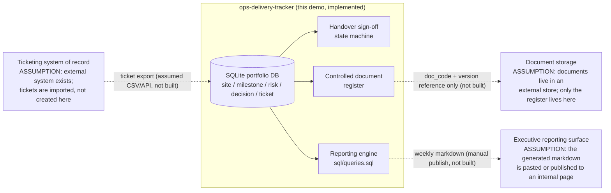

# Integration Diagram

> DESIGN ASSUMPTIONS ONLY. No interface in this diagram is a real
> integration. Nothing in this repository connects to any external system.
> Each external interface below is labelled with its assumption status.

## System context (Mermaid)

## Interface inventory

| Interface | Direction | Status | Assumption being made |
|---|---|---|---|
| Ticket intake | Ticketing system -> tracker | DESIGN ASSUMPTION, not implemented | A ticketing tool can export id, priority, SLA target, created/resolved timestamps in a stable shape |
| Executive report distribution | Tracker -> reporting surface | DESIGN ASSUMPTION, not implemented | The generated one-page markdown is the artifact; distribution is a human or scheduler step outside this demo |
| Controlled document storage | Register -> document store | DESIGN ASSUMPTION, not implemented | Documents themselves live elsewhere; this system governs registration, version, approval, and obsolescence metadata only |
| Seed / demo data load | Local script -> SQLite | IMPLEMENTED | scripts/build_db.py and the in-memory seed path used by tests and report generation |

## Why the assumptions are drawn this way

- Ticketing stays the system of record for ticket work; the tracker consumes
  timestamps for SLA/MTTR rather than duplicating ticket workflow. That keeps
  one source of truth for operations and one for portfolio governance.
- The document register is deliberately metadata-only: governance (who owns
  it, which version is current, what was retired and why) is the part that
  was missing in discovery, not file storage.
